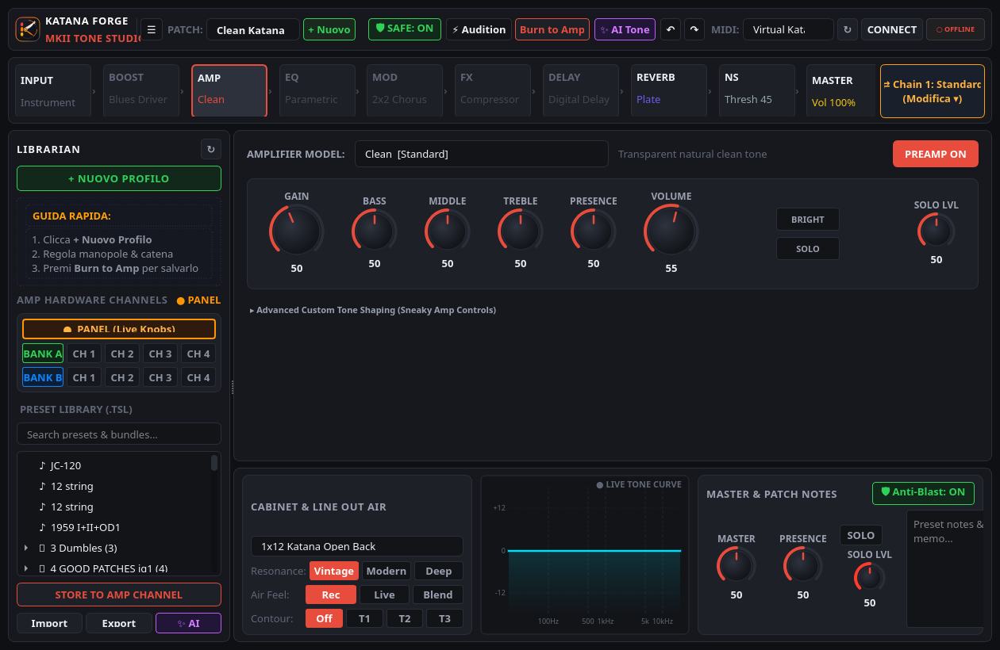
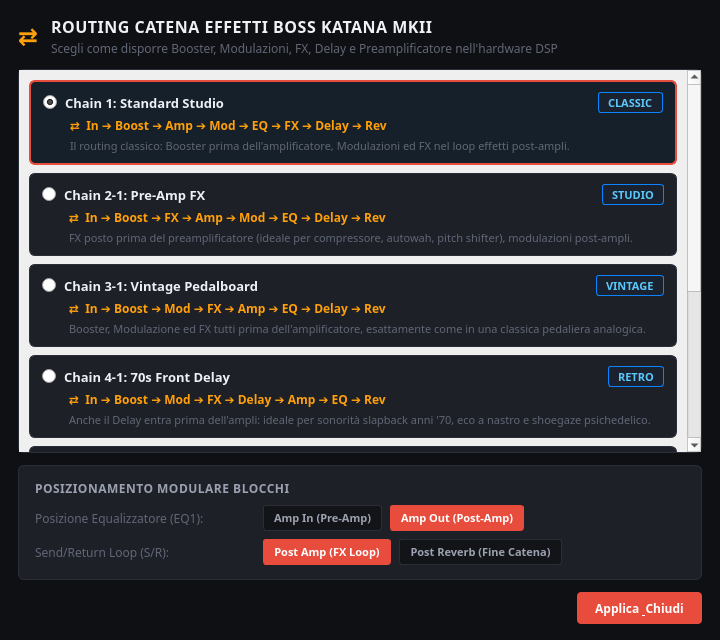
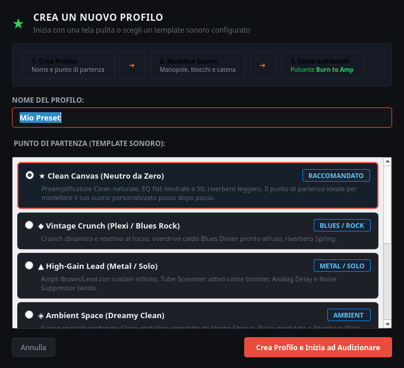
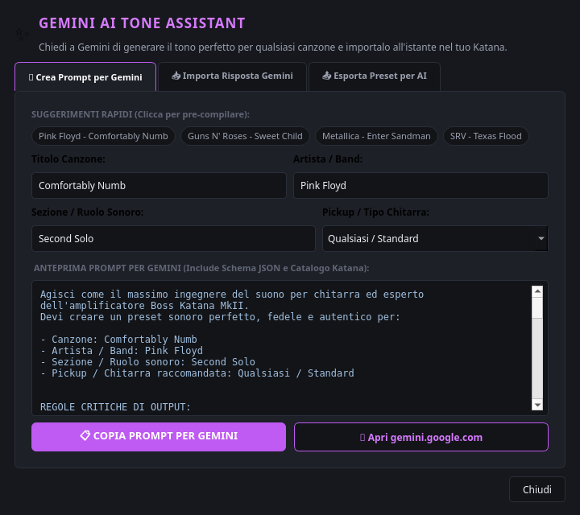
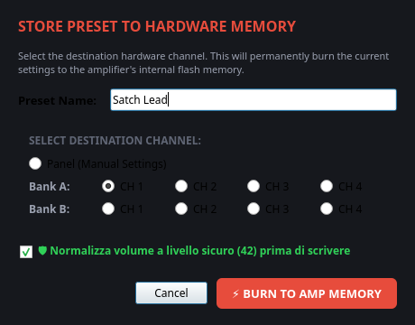

# ⚡ Katana Forge — MkII Tone Studio

<p align="center">
  
</p>

<p align="center">
  <b>Modern DAW-style Tone Studio & Deep Sound Designer for Boss Katana MkII Amplifiers</b><br>
  <i>Built with Python 3, PyQt6, and native ALSA / Roland SysEx protocols.</i>
</p>

<p align="center">
  
  
  
  
  
</p>

---

## 🌟 Overview

**Katana Forge** is a lightweight, ultra-responsive tone studio and deep sound editor designed for the **Boss Katana MkII** family (Katana 50 MkII, 100 MkII, 100/212 MkII, Head MkII, and Artist MkII).

Inspired by modern guitar software like Neural DSP Archetype and Line 6 Helix Native, Katana Forge replaces sluggish legacy software with a sleek, GPU-accelerated dark user interface, instant bi-directional hardware communication, safety-first volume protection, and artificial intelligence tone synthesis.

---

## 📸 Screenshots

### 🎛️ Main Studio Workspace
Interactive horizontal signal chain, real-time responsive knobs, live tone curve analyzer, permanent Master & Cabinet dock, and collapsible preset librarian.


---

### 🔀 All 7 Hardware Signal Chain Topologies
Visualized audio flow across all DSP routing topologies with modular pre/post amp placement for EQ1 and the effects loop.


---

### 🎨 Guided Profile Creator & Sonic Templates
Create clean canvas presets or jumpstart sound design with curated templates tailored to specific genres.


---

### ✨ Gemini AI Tone Assistant
Generate authentic artist/song presets using AI prompts, or paste JSON presets directly into the editor for instant auditioning.


---

### 🛡️ Anti-Blast Safe Audition Guard & Channel Burn
Protect your hearing and guitar cab speakers from catastrophic volume spikes during auditioning, then burn directly to Katana Channel memory.


---

## 🚀 Key Features

* **🎛️ Modern Neural DSP-Style Dark UI**: Fluid rotary knobs, visual EQ frequency response, responsive level meters, and high-DPI scaling.
* **🔀 7 Hardware Signal Chain Topologies**:
  - `Chain 1`: Standard Studio (`In ➔ Boost ➔ Amp ➔ Mod ➔ EQ ➔ FX ➔ Delay ➔ Rev`)
  - `Chain 2-1`: Pre-Amp FX (Compressor / Auto-Wah / Pitch-Shifter before preamp)
  - `Chain 3-1`: Vintage Analog Pedalboard (`Boost ➔ Mod ➔ FX` before amp)
  - `Chain 4-1`: 70s Front Delay (Tape Slapback before preamp saturation)
  - `Chain 2-2`: Mod-First Drive (Hendrix-style Uni-Vibe / Phaser into Fuzz)
  - `Chain 3-2` & `Chain 4-2`: Modular variations
  - Real-time horizontal visual re-ordering of audio blocks with directional flow arrows.
* **🔓 28 Legendary "Sneaky Amps"**: Full access to hidden Roland/Boss GT-100 preamp models tucked inside the Katana DSP firmware:
  - *Fender Clean*: Clean Twin (1965 Blackface), Pro Crunch, Deluxe Crunch
  - *Vintage Rock*: Tweed Bassman, Marshall JMP Crunch, VO Drive (AC-30), Matchless D/C-30
  - *Classic Plexi*: Marshall 1959 Super Lead (Ch1, Ch2, and Jumpered Ch1+Ch2)
  - *High Gain*: Mesa/Boogie Mark IIc+ & Mark IV, Soldano SLO-100, Hughes & Kettner TriAmp
  - *Modern Metal*: Mesa/Boogie Dual Rectifier (Vintage & Modern Lead channels)
* **🛡️ Safe Audition Guard & Level Normalizer**:
  - Eliminates dangerous volume blasts ($\le 42$ volume ceiling during preset browsing and audition).
  - Psychoacoustic gain leveling: high-gain leads and whisper cleans play at identical, comfortable acoustic loudness.
  - Automatically suppresses sudden solo boosts and level clips during testing.
* **✨ Gemini AI Tone Assistant**:
  - Generate customized prompts for any song, band, or solo with recommended pickup selections.
  - Paste structured JSON directly from Gemini, Claude, or ChatGPT to instantly audition the tone.
* **📁 Comprehensive Preset Librarian (.TSL)**:
  - Over 1,800 bundled artist and studio presets ready for instant loading.
  - Full support for both Boss Tone Studio MkII (`data[0]`) and MkI (`patchList`) format files.
  - Instant search filtering and live tree navigation.
* **⚡ Native SysEx Hardware Synchronization**:
  - Zero-latency bidirectional parameter synchronization with USB MIDI on Linux.
  - One-click **Burn to Amp** to save directly into hardware channel memories (Bank A/B, Channels 1-4).
  - Built-in offline simulation mode for tone sculpting on the go without the amplifier connected.

---

## 📦 System Requirements & Installation

### Requirements
* **Python**: 3.10 or higher
* **Operating System**: Linux (Ubuntu, Debian, Fedora, Arch, openSUSE, etc.), macOS, or Windows
* **Hardware**: Boss Katana MkII (50, 100, 100/212, Head, or Artist) connected via standard USB cable

### Quick Setup

1. **Clone the repository**:
   ```bash
   git clone https://github.com/your-username/katana-forge.git
   cd katana-forge
   ```

2. **Install dependencies**:
   ```bash
   pip install -r requirements.txt
   ```
   *(On Debian/Ubuntu, you can also install via apt: `sudo apt install python3-pyqt6`)*

3. **Launch Katana Forge**:
   ```bash
   python3 run_modern_editor.py
   ```
   *or:*
   ```bash
   ./start_katana_modern.sh
   ```

---

## 🧪 Automated Testing

Katana Forge includes a comprehensive unit test suite covering SysEx encoding, parameter boundary clamping, safe audition calculations, and TSL parser validation:

```bash
python3 -m unittest discover -s tests -v
```

All 20 unit tests execute in milliseconds:
```text
test_build_gemini_prompt (test_ai_preset.TestAiPresetEngine) ... ok
test_parse_and_apply_ai_preset (test_ai_preset.TestAiPresetEngine) ... ok
test_booster_models (test_amp_catalog.TestAmpCatalog) ... ok
test_chain_routes_hardware_topologies (test_amp_catalog.TestAmpCatalog) ... ok
test_standard_and_sneaky_amps (test_amp_catalog.TestAmpCatalog) ... ok
test_create_new_profile_templates (test_patch_model.TestKatanaPatchModel) ... ok
test_default_initialization (test_patch_model.TestKatanaPatchModel) ... ok
test_dynamic_chain_blocks_ordering (test_patch_model.TestKatanaPatchModel) ... ok
test_parameter_change_and_dirty_tracking (test_patch_model.TestKatanaPatchModel) ... ok
test_safe_audition_guard_clamping (test_patch_model.TestKatanaPatchModel) ... ok
test_undo_redo (test_patch_model.TestKatanaPatchModel) ... ok
test_build_full_patch_sysex (test_patch_transmitter.TestPatchTransmitter) ... ok
test_default_template_loading (test_patch_transmitter.TestPatchTransmitter) ... ok
test_safe_volume_calculation (test_patch_transmitter.TestPatchTransmitter) ... ok
test_create_dt1 (test_sysex.TestRolandSysEx) ... ok
test_create_rq1 (test_sysex.TestRolandSysEx) ... ok
test_current_channel_address (test_sysex.TestRolandSysEx) ... ok
test_roland_checksum_calculation (test_sysex.TestRolandSysEx) ... ok
test_load_bundle_tsl (test_tsl_manager.TestTslManager) ... ok
test_load_mk2_tsl (test_tsl_manager.TestTslManager) ... ok
----------------------------------------------------------------------
Ran 20 tests in 0.009s
OK
```

---

## ⌨️ Keyboard Shortcuts

| Shortcut | Action |
| :--- | :--- |
| `Ctrl+N` | **Create New Profile** (Opens sonic templates dialog) |
| `Ctrl+R` | **Signal Chain Routing** (Opens 7-route topology customizer) |
| `Ctrl+Z` | **Undo** last parameter tweak |
| `Ctrl+Y` | **Redo** last parameter tweak |
| `Ctrl+W` | **Burn to Amp** (Store current patch into Katana channel memory) |

---

## 📜 Architecture & Codebase Structure

```text
katana-forge/
├── katana_modern/             # Core application package
│   ├── core/                  # Engine logic, MIDI backend & Roland protocols
│   │   ├── ai_preset_engine.py    # Gemini AI tone prompt builder & parser
│   │   ├── amp_catalog.py         # Standard amps, 28 Sneaky Amps & 7 chain routes
│   │   ├── midi_backend.py        # Direct ALSA snd_rawmidi USB connector
│   │   ├── patch_model.py         # Reactive parameter model & safe volume guard
│   │   ├── patch_transmitter.py   # 16-packet bulk DT1 patch encoder
│   │   ├── roland_sysex.py        # Checksums & Roland packet frames
│   │   └── tsl_manager.py         # Tone Studio Library (.tsl) importer/exporter
│   ├── resources/             # High-DPI logos and default template SysEx
│   │   ├── app_logo.png           # 256x256 application icon
│   │   ├── app_logo.svg           # Scalable vector logo
│   │   └── default.syx            # Official Katana MkII base template
│   └── ui/                    # Dark DAW-style Qt components
│       ├── components/        # Custom widgets (knobs, analyzer, chain bar, dock)
│       ├── dialogs/           # Routing, profile, AI tone, & write modals
│       ├── panels/            # Amp, booster, mod, delay, reverb, eq, master panels
│       ├── sidebar/           # Tone Studio patch librarian
│       ├── header_bar.py      # App header, status badges & MIDI selector
│       ├── main_window.py     # Main window & keyboard shortcuts
│       └── theme.py           # Color palette, stylesheets & fonts
├── docs/                      # Documentation & visual assets
│   └── screenshots/           # High-resolution screenshots
├── saved_patches/             # Over 1,800 curated .tsl presets
├── tests/                     # Automated unittest suite
├── .gitignore                 # Standard Python & OS ignore rules
├── LICENSE                    # GNU General Public License v3.0
├── README.md                  # Project documentation
├── requirements.txt           # Minimal pip dependencies (PyQt6)
├── run_modern_editor.py       # Main Python entrypoint
└── start_katana_modern.sh     # Quick shell launcher
```

---

## 📄 License

This project is licensed under the **GNU General Public License v3.0** — see the [LICENSE](LICENSE) file for details.

*Disclaimer: Boss, Roland, and Katana are registered trademarks of Roland Corporation. This independent open-source project is not affiliated with or endorsed by Roland Corporation.*
